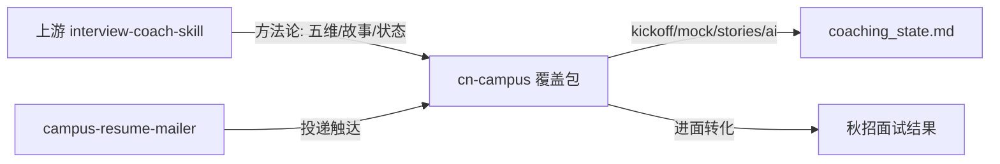

# interview-coach 落地可行性

> 结论性短文，与 [AI面试训练方案_可行性.md](AI面试训练方案_可行性.md)（训练流程）、[`.cursor/skills/interview-coach-cn-campus/`](.cursor/skills/interview-coach-cn-campus/SKILL.md)（覆盖包）配套阅读。
> 生成：2026-10-02

---

## 总判

**可行，且本仓库已越过「能不能用」阶段，进入「能不能持续用好」阶段。**

- 上游形态：纯 Markdown Skill（`SKILL.md` + `references/`），无服务端依赖；在 Claude Code / Cursor / Codex 均可激活。
- 本仓库现状：已有覆盖包 [`.cursor/skills/interview-coach-cn-campus/`](.cursor/skills/interview-coach-cn-campus/SKILL.md)，默认 PLC 电气预设，状态文件 [`coaching_state.md`](coaching_state.md) 已写入画像与主故事，并扩展了国内 AI 面命令 `ai` / `ai-mock`。
- 秋招 ROI：五维打分、故事库、mock、prep、debrief、薪资谈法对国内校招**高杠杆**；LinkedIn / cold outreach / bar raiser / FAANG 默认语境**应继续禁用或改写**。

## 上游项目快照（2026-10）

| 项 | 事实 |
|----|------|
| 仓库 | [noamseg/interview-coach-skill](https://github.com/noamseg/interview-coach-skill) |
| 许可 | MIT（可覆盖、可本地化、可商用改造） |
| 规模 | ~2300 stars / ~360 forks；最近 push 约 2026-05；仍活跃讨论 |
| 版本 | v1–v3 **已发布**（全生命周期 23 命令）；v4 语音/UI、v5 Web 平台 **仅规划** |
| 激活 | Claude：`SKILL.md`→`CLAUDE.md`；Codex：→`AGENTS.md`；Cursor：放进 Skills 目录即可 |
| 成本门槛 | 需付费模型额度（Claude / ChatGPT / Cursor），项目本身免费 |

核心能力可复用：Substance/Structure/Relevance/Credibility/Differentiation 五维、根因诊断树、`coaching_state.md` 跨会话记忆、storybank、mock/practice、analyze/debrief、outcome calibration。

不可指望（当前版本）：真实语音/画面评分（v4 才规划）、替代真机 PLC 评测、保证命中牛客/企业 AI 面真题。

## 本仓库已落地 vs 缺口

**已落地（高置信可用）**

- 全局中文校招语境 + 禁用北美默认假设（见 [`SKILL.md`](.cursor/skills/interview-coach-cn-campus/SKILL.md)）
- 5 个最高杠杆覆盖：`kickoff` / `mock` / `prep-research` / `salary-negotiate` / `stories`（见 [`MINIMAL_CHANGES.md`](.cursor/skills/interview-coach-cn-campus/MINIMAL_CHANGES.md)）
- 岗位预设 `plc-electrical` + AI 面专项 [`ai-interview-cn.md`](.cursor/skills/interview-coach-cn-campus/references/ai-interview-cn.md)
- 与 `campus-resume-mailer` 分工清晰：mailer 触达，coach 转化

**刻意未做（合理，省时间）**

- 未全量 fork 上游 `references/commands/*.md`（23 条细协议）
- `linkedin` / `outreach` 未国产化（Boss/实习僧/宣讲优先于 LinkedIn）
- `present`、完整 `progress` 校准闭环、上游 examples 英文化量大内容

**能力边界（与 [`AI面试训练方案_可行性.md`](AI面试训练方案_可行性.md) 一致）**

- 听不到声音、看不到画面 → 表达态需候选人自录贴转写
- 不验证程序/接线真伪 → 只练表达、排查章法、安全意识、可信边界
- 不编公司流程与薪资带宽 → 需学长/官网核实

## 可行性分维评分

| 维度 | 结论 | 说明 |
|------|------|------|
| 技术落地 | 高 | 文件型 Skill，Cursor 已跑通；无需后端 |
| 校招适配 | 中高 | 覆盖包已纠偏；全量 23 命令国产化非必需 |
| 秋招即时收益 | 高 | 故事库 + mock + AI 面流程已直接服务博众等场次 |
| 完整产品化 | 低（现阶段） | 上游 v5 才是 Web 平台；自建平台成本远大于覆盖包 |
| 风险 | 可控 | 直接套用上游英文默认会「教偏」；必须以覆盖包为准 |

## 推荐落地策略（已确认）

不做「再克隆一份完整上游当主系统」；维持 **覆盖包优先**，按秋招节奏加深：

1. **当场次闭环**：真面后跑 `debrief` → 写入 `Interview Intelligence`；有转写再 `analyze`。流程见 [`debrief-analyze-cn.md`](.cursor/skills/interview-coach-cn-campus/references/debrief-analyze-cn.md)。
2. **故事库补齐**：主项目已完成；菲斯特 / ECU / 社团已按覆盖包补到「可追 3 层 + 两版口述稿」，写入 [`coaching_state.md`](coaching_state.md) 的 Storybank。
3. **每场 AI 面固定入口**：说「按 `ai` 流程跑」即可复用六阶段，不再重写方案。
4. **按需加深命令**：出现 offer 再深用 `negotiate`；出现 JD 批量筛选再补 `decode` 中文版；不提前做 LinkedIn。
5. **可选对照**：需要细粒度英文协议时再 clone 上游对照 `references/commands/*.md`，日常仍以 `*-cn.md` 为准（[`MINIMAL_CHANGES.md`](.cursor/skills/interview-coach-cn-campus/MINIMAL_CHANGES.md) 已写明）。

## 明确不做

- 不为「完整性」全量汉化 23 命令与英文 examples
- 不承诺语音评分或 AI 面真题命中
- 不把上游 FAANG / bar raiser / RSU 剧本带回默认路径
